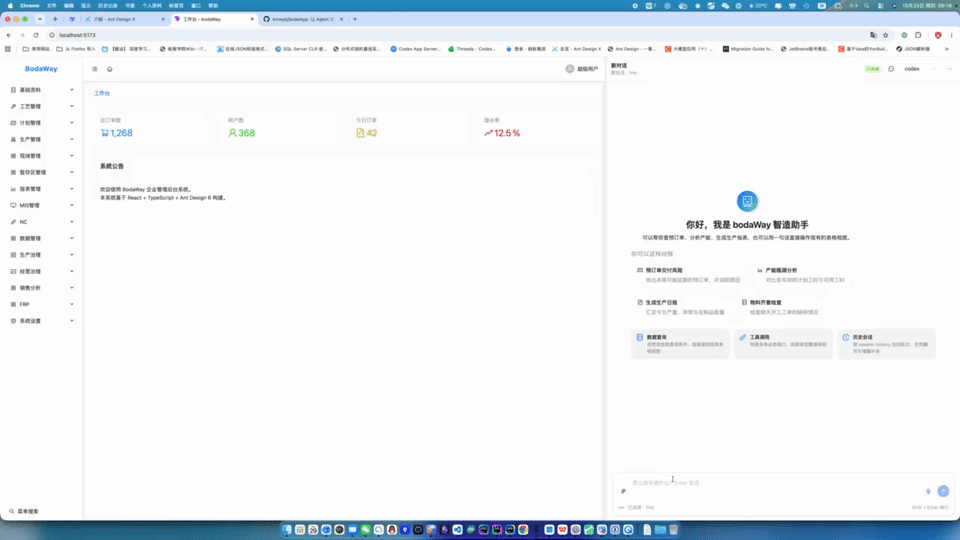

# bodaWay

该项目是车间管理系统的前端（React 19 + antd 6 + Vite），桌面端由 Go/MyGo 外壳装载。

它和普通后台管理系统的区别只有一个，但影响全局： **页面里常驻一个 AI Agent，它不只是聊天，而是能"看见"
当前页面并直接操作它** —— 取某一行数据、改筛选条件、选中单据、打开表单、批量填字段、提交。这条通道叫 **界面桥（UI Bridge）**
，是本项目最核心、也最值得先读的设计。

```text
用户 ── 说话 ──►  Agent（后端模型）
                    │  ui_observe / ui_act / ui_navigate
                    ▼
          ws: ui.request  ──►  界面桥  ──►  页面 / 表格 / 弹窗
                    ▲                        │
                    └───  ui.response  ◄─────┘
                          快照 / 补丁 / 结果
```

---

---

## 快速开始

```bash
npm install

npm run dev        # 前端开发服务（http://localhost:5173）
npm run build      # tsc -b && vite build
npm run lint       # oxlint

npm run app:dev    # 桌面壳开发（MyGo + Vite dev server，热更新可用）
npm run app:build  # 打包桌面应用
npm run gen:api    # 从后端 schema 生成 src/api/schemas
```

> 桌面壳以 `app/` 为工程根，`app:build` 会先执行 `npm run build`，再把 `dist/` 内嵌进可执行文件；版本号与安装包标识来自
> `package.json` 与 `app/mygo.config.ts`。

### 环境变量

按需写到 `.env.local`（`vite.config.ts` 用 `loadEnv` 读取，不写也能跑）。

| 变量                   | 默认                    | 说明                                                    |
|------------------------|-------------------------|---------------------------------------------------------|
| `VITE_API_BASE_URL`    | `/v1/boda`              | 业务接口前缀，与 Vite 代理保持一致                      |
| `VITE_API_TARGET`      | `http://localhost:8080` | 开发代理目标，`/v1/boda` 转发到这里                     |
| `VITE_USE_MOCK`        | `true`（仅 dev）        | 设为 `false` 才走后端；正式构建恒为真实接口             |
| `VITE_APP_ENV`         | 由构建目标推导          | `debug` / `release`，覆盖"这次要跑哪一支流程"           |
| `VITE_AGENT_WS_URL`    | 空                      | **配了才连真实 Agent 服务**，否则用本地演示脚本         |
| `VITE_AGENT_WS_TOKEN`  | 空                      | 没有登录态时的连接凭证；有登录 token 时优先用登录 token |
| `VITE_AGENT_FILES_URL` | `/ws/files`             | Agent 附件上传/下载端点，需与代理前缀一致               |

> Agent 鉴权只能走 `?token=`（浏览器给 WebSocket 设不了请求头），凭证优先级：登录 token > `VITE_AGENT_WS_TOKEN`。

---

## 目录结构

```text
src/
├── api/          # 接口封装：request（超时/鉴权/错误归一）+ modules + schemas
├── services/     # 依赖业务模型的逻辑（权限、SQL 结果、BI）
├── utils/        # 换项目能原样用的纯函数（env / string / date / blank）
├── store/        # 登录、权限、页签、组织（auth / permission / tabs）
├── components/
│   ├── grid-table/   # GridTable / FilterTable 体系（基于 @visactor/vtable 的封装）
│   ├── commands/     # 页面命令（CommandBar 的按钮从哪来、怎么分组排序）
│   └── nc/           # NC(ERP) 相关弹窗与 BOM 矩阵
├── layouts/
│   ├── MainLayout.tsx       # 菜单 + 页签 + 工作台级界面桥
│   └── WorkbenchLayout.tsx  # 左主布局 + 右 Agent 面板（可拖拽分栏）
├── pages/
│   ├── registry.ts   # 按 View 自动注册页面（import.meta.glob）
│   ├── agent/        # Agent 对话：protocol / transport / chat / components / ui-bridge
│   └── views/        # 业务页面，目录层级拼成 View：V0189/V0279/V0280 → V0189_V0279_V0280
└── main.tsx
app/                # Go/MyGo 桌面外壳（只负责开窗与加载前端）
docs/               # 分主题的开发文档（见文末索引）
```

**页面按 View 建目录，无需手工登记**：`src/pages/views/V0189/V0279/V0280/index.tsx` 自动对应 View `V0189_V0279_V0280`
；菜单给一个更深的 View 时，逐级向上取最近注册的祖先页面，兜底才是通用列表页 `ViewPage`。

---

## 核心：界面桥（UI Bridge）

### 它解决什么问题

大模型看不见你的界面。如果只给它数据库或接口，它不知道：

- 用户说的"第 5 条"在 **当前筛选 + 当前排序**下是哪一行；
- 这个页面上有哪些按钮、此刻哪些是灰的、为什么灰；
- 编辑弹窗里 16 个字段叫什么、哪个被锁住、哪些必填、刚刚提交失败了因为哪一项。

把这些写进系统提示词是最常见的做法，然后必然与真实页面脱节。本项目的做法相反： **页面自己实时描述自己**（快照），
**页面自己声明每条命令怎么执行**（handlers），桥只做三件事：把描述合成一份快照发给模型、执行命令、按差异回执。

于是新增一个页面不需要改 Agent 侧任何代码，只要在页面目录下放一个 `bridged.ts`。

### 三层宿主：谁回答"在哪""这页能干什么""弹窗里有什么"

| 层       | 挂在哪                   | 回答什么                                              | 注册方式                                                             |
|----------|--------------------------|-------------------------------------------------------|----------------------------------------------------------------------|
| 工作台级 | `MainLayout`，全局唯一   | 你在哪个页面、能打开哪些页面、怎么打开                | `useWorkbenchBridge({ currentView, navigation, canOpen, openView })` |
| 页面级   | 各业务页面，按 view 索引 | 这一页的 guide / actions / filters / data / selection | `useUIBridgeHost(view, host)`                                        |
| 弹窗级   | 弹窗组件，**仅打开期间** | 表单字段、表单内命令、提交语义                        | `useUIBridgeDialog(view, host, open)`                                |

三点设计后果，值得先记住：

1. **用户停在主页也能对话**。因为工作台级宿主常驻，agent
   至少知道"你在工作台，这些页面可以打开"，不会因为"没在任何页面里"就哑火。
2. **弹窗自己注册自己**。一个页面上有五个弹窗，如果让页面转述，`index.tsx` 里就要写五份字段映射 + 动作表 +
   处理函数，页面文件立刻成为瓶颈。现在弹窗的字段与提交语义都留在弹窗自己的文件里。
3. **覆盖规则在桥里统一实现**：弹窗打开时，它的 actions 顶掉页面工具栏动作、`mode` 变 `form`、`filters` / `data`
   被清空（它们确实被弹窗挡住了）。页面与弹窗都不用各写一遍。

### 一次往返的完整时序

Agent 侧有三个工具（后端 `buibuiCodex` 实现），全部由一条 **反向 RPC** 落地：服务端下发 `kind: 'ui'` / `type: 'ui.request'`
，浏览器用 `kind: 'client'` / `type: 'ui.response'` 通过 `replyTo` 回执。

```text
① 打开页面  ui_navigate(view)
   服务端 → 桥    ui.request { op: "navigate", view }
   桥 → 页面      openView(view)，然后轮询 ready()（上限 5s）
   桥 → 服务端    ui.response { snapshot: 整页快照, rev }
                 ← 桥在这里记下"模型手里那份"的结构指纹 fp

② 执行命令  ui_act(cmd, params, rev)
   服务端 → 桥    ui.request { op: "act", cmd, params, rev }
   桥            rev 校验 → 在 actions 里找 cmd → disabled 校验 → handler(params)
   桥 → 页面      真正执行（可能异步：拉数据、开弹窗、提交）
   桥            等落定 → 取新快照 → 与锚点比结构/变化 → 决定档位
   桥 → 服务端    ui.response { result, patch 或 snapshot, rev }
```

**回执必须恰好发一次**，失败也要发。服务端在同步等待，不回答就是超时 ——
模型只会看到"超时"，永远不知道"为什么不行"。所以桥里每一条失败路径都翻译成了模型可读的原因（`rev`
不对、命令不存在、命令被禁用及原因、页面没接桥、没权限）。

### 快照是"目录"，不是"数据"

这是全文最容易被写错的一条。快照里 **不放数据行**。

```jsonc
{
  "v": 5,
  "rev": 7,                 // 乐观锁：下一条命令必须带它
  "fp": "9c1f4a02",         // 结构指纹：补丁的 basedOn 要对上它
  "view": "V0189_V0279_V0280",
  "title": "计划管理 > 预订单 > 预订单管理",
  "mode": "list",
  "guide": { "steps": ["..."], "terms": { "第几条": "offset = N-1" } },
  "actions": [{ "id": "publish", "label": "发布", "disabled": true, "disabledReason": "需要先选中一行" }],
  "filters": [{ "id": "WorkPlace", "label": "生产产地", "type": "text", "value": "" }],
  "selection": { "count": 0, "activeRowId": null, "rowIds": [] },
  "data": {
    "name": "data", "rowKey": "ID", "total": 3281, "loaded": 3281,
    "columns": [{ "field": "OrderCode", "title": "订单号", "type": "text" }],
    "sorts": [{ "field": "YPDate", "order": "desc" }],
    "grouped": false, "summaryRow": 3280
  }
}
```

为什么不是"顺手把前 20 行也塞进去"：

- 那 20 行 **和用户屏幕上的 20 行不是一回事**（排序、分组、统计行都在表格内部），模型会拿错行；
- 每行 50 多列全塞进去，一帧就是几万 token，而绝大多数判断只看认单、状态、数量那几列。

所以数据按需取：`data.page({ offset, limit, fields })`。 **`offset` 是显示行号，0 就是用户屏幕第一行** —— 用户说"第 5 条"就传
`offset: 4`，`getRowByIndex` 跟随表格的显示顺序，这条语义由表格桥保证（见下）。要整单核对时用 `data.row({ rowId })`
按业务主键取完整记录（含表格没显示的字段）。

另外两条约定：

- **模型能做的任何事都必须出现在 `actions` 里**。只发数据不发命令，模型只能干猜 —— 筛选条件就踩过这个坑。
- **`guide` 只写快照里推不出来的东西**：操作顺序、前置条件、业务术语映射、陷阱。不写命令清单（会与 `actions`
  平行维护且必然对不上），也不从页面数据生成（它是可信内容，`data` 是不可信内容，混起来等于把用户文本当指令）。

### 回执三档：full / patch / result

早期实现每次都回整页快照，结果是模型在"翻页读数据"这类高频动作上被同一份目录反复冲刷上下文。现在
**由桥比对新旧快照自动决定发什么**，页面通常一个字都不用写：

| 档位     | 什么时候                                                                                                   | 回什么                              |
|----------|------------------------------------------------------------------------------------------------------------|-------------------------------------|
| `full`   | 模型手里没有这一页的快照（首次 observe/navigate）、或**结构指纹变了**（开弹窗、切模式、列目录/命令表变了） | 整页快照 + 新 `rev`                 |
| `patch`  | 结构没变、但状态变了（默认档）                                                                             | `result` + 只含变化段与变化项的补丁 |
| `result` | 执行完状态与上次发出去的一模一样                                                                           | 只有 `result`                       |

判断依据只有一条： **模型手里那份快照，合并完这段变化之后，还差不差它没见过的东西**。差 → `full`，不差 → `patch`。

补丁本身也是增量的（v5）：填 2 个字段就只回 2 个字段，不会把整张 16 项表单重发一遍。

```jsonc
{
  "ok": true, "rev": 8, "result": "已设置「预排日期」= 2026-11-01",
  "patch": {
    "view": "V0189_V0279_V0280",
    "basedOn": "9c1f4a02",       // 对不上手里的 fp 就别硬合，先 ui_observe
    "form": { "id": "yupaiOrderEdit", "fields": [{ "id": "YPDate", "value": "2026-11-01" }] }
  }
}
```

命令可以显式覆盖档位（`returns: 'result' | 'patch' | 'full'`），但 **正常不用写**。唯一值得写的是纯读命令标 `'result'`
：它不改状态，桥能省掉"等页面落定 + 取新快照"这一趟，回执立刻发出。

`rev` 是乐观锁：命令必须带上看快照时的 `rev`，不匹配就拒绝并要求重新 observe。版本号 **按 view 分域** ——
切页面和当前页的版本本来就没关系，共用一个计数器必然混乱。

### 表格桥：`createTableBridge`

"这一列有哪些字段、一共几行、按什么排序、第 N 行是什么"这些只有表格实例知道（排序分组发生在表格内部，页面 state
里根本没有）。所以通用适配层统一实现读能力，页面只给 **列定义**和 **取实例的函数**：

```ts
const tableBridge = createTableBridge({
    columns: COLUMNS,                  // AppColumnDef[] 或 ColumnsDefine 都认
    rowKey: 'ID',                      // 主键一般不显示在列里，但 agent 必须知道它
    readTable: () => tableRef.current, // 取值函数：表格重建也不用重新装配
    keyFields: ['OrderCode', 'Qty', 'WorkPlace'],  // 默认投影列（52 列全给是最贵的一帧）
    columnHints: {WorkPlace: '可选值：越南工厂 / 义乌工厂'},
    waitSelected: (rowId) => waitForActiveRow(rowId), // 页面按钮 disabled 读 state，要等它落地
});
// 快照里 data: tableBridge.data()；动作拼 tableBridge.actions()；处理函数拼 tableBridge.handlers
```

它固定提供三条命令，前缀是表名（默认 `data`，一页两表时给不同 `name` 避免撞 ID）：

| 命令          | 用途                     | 关键语义                                                                             |
|---------------|--------------------------|--------------------------------------------------------------------------------------|
| `data.page`   | 按**显示行号**取数据     | `offset` 0 = 屏幕第一行；默认只回 `keyFields`，要全部列传 `fields: "*"`；上限 200 行 |
| `data.row`    | 按**业务主键**取完整一行 | 不做列白名单（表格没显示的字段也在内），用于核对整单                                 |
| `data.select` | 选中行                   | 只认当前显示里的 rowId，命中数交给表格判定并翻译成人话                               |

同时做了三件"必然的收缩"：空值不出现（省略即未填，不是 0）、长文本截断（默认 120 字）、分页上限。`total` 与用户屏幕行数一致（含分组组行与统计行），
`summaryRow` 单独标出来 —— 否则模型会把"共 3281 条"的合计行当成一条单据。

### 表单桥：`createFormWriter`

一条 `ui_act` 只能带一条命令，所以"一次改多处"必须做成批量命令，否则 16 个字段就是 16 次往返、16 段补丁、16
轮推理，模型每轮还要重读一遍字段表。

```ts
const writer = createFormWriter({
    fields: () => fields,                      // 每次调用现取（下拉候选可能随数据变）
    fieldLock: (id) => fieldLock(id),          // 锁的唯一真相在弹窗里，桥不再推一遍
    write: (patch) => form.setFieldsValue(patch),
    sequenced: [{id: 'OrderCode', unlocksOthers: true, run: checkOrderCode}],
});
```

它回答三个问题就够： **有哪些字段**、 **哪个字段此刻为什么不能改**、 **写完还有后续动作的字段怎么处理**
（订单号要检测、业务员要查工号）。剩下的（解析入参、逐字段判锁与类型转换、顺序字段先走、一次写入、拼回执）都在桥这一层，新弹窗不用再抄一遍。

两个细节，改之前先读：

- **逐字段判断、一次写入**：逐个 `setFieldsValue` 会让界面渲染多次、校验跑多次。
- **别自己推"检测通过 = 可写"**：检测类字段成功后界面的锁（React state）还没提交，立刻写别的字段会被判成未解锁，只能轮询
  `fieldLock` 等它变。

### 怎么给一个页面接桥

**第 0 步：确认 View 能解析到它。** 页面目录按层级拼成 View（`V0189/V0279/V0280` → `V0189_V0279_V0280`，`registry.ts`
自动注册）；页面从 props 拿到 `view` 后原样传给桥即可， **不要自己拼字符串**。

**第 1 步：在页面目录下建 `bridged.ts`，导出纯函数工厂。** 下面是骨架示意，完整实现见 `V0189/V0279/V0280/bridged.ts`：

```ts
// V0189/V0279/V0280/bridged.ts
export function createYupaiOrderBridge(read: () => YupaiOrderBridgeContext): UIBridgeHost {
    const tableBridge = createTableBridge({columns: COLUMNS, rowKey: 'ID', readTable: () => read().readTable()});

    return {
        // 纯读取，不要有副作用；桥会自己决定发全量还是补丁，所以可以放心算细
        snapshot: () => ({
            view: read().view,
            title: '计划管理 > 预订单 > 预订单管理',
            mode: 'list',
            guide: PREORDER_GUIDE,
            actions: [...read().commands.map(toAction), ...tableBridge.actions()],
            filters: currentFilters(read().filter),
            data: tableBridge.data({active: read().activeRow}),
        }),
        handlers: {...buildHandlers(read), ...tableBridge.handlers},
        ready: () => read().ready,   // ui_navigate 会等它变 true 再回执
    };
}
```

**第 2 步：页面里注册。**

```tsx
const bridgeContext = useMemo<YupaiOrderBridgeContext>(() => ({
    view,
    commands,
    activeRow,
    ready,
    readTable,
    readActiveRow,
    applyFilter
}), [/* ... */]);
const bridge = useMemo(() => createYupaiOrderBridge(() => bridgeContext), [bridgeContext]);
useUIBridgeHost(view, bridge);
```

**第 3 步：弹窗接入（有表单弹窗时）。** 弹窗自己注册、自己给字段与提交语义：

```tsx
const dialogBridge = useMemo(() => createYupaiOrderEditBridge(() => context), [context]);
useUIBridgeDialog(view, dialogBridge, open);   // open 为 false 时自动让位给页面
```

**第 4 步：跑起来自查。** 开发期若页面注册了桥却没有 `bridged.ts`，控制台会明确报错并列出已接入的页面清单。

工作台级宿主已由 `MainLayout` 常驻注册，页面不用管。

### 五条硬约束（都是踩过坑才定下来的）

1. **`bridged.ts` 文件存在本身就是"已接入"的标记**。工作台导航清单靠 `import.meta.glob('../../views/**/bridged.ts')` 只取
   key 判定。手工清单会漏登记，运行时探测在"还没进目标页"时求值为空，会话内累计一重启就丢 ——
   文件存在是唯一既静态、又与代码同生共死的信号。删掉它，页面立刻对 agent 隐身（页面功能不受影响）。
2. **判"接没接桥"必须走 `resolveViewPath`**
   ，不能用"任意祖先有标记"。父目录接了桥，子目录自己没接也会被算成已接入，导航里就会出现"能打开、不能操作"的页面。
3. **`bridged.ts` 只放常量与纯函数**：不导出组件、不调 hook。页面把"怎么取当前状态"以 **取值函数**传进来。在工厂里调 hook
   就成了"在页面的 hook 回调里调 hook"。
4. **宿主存 getter，不存快照对象**。React 每次渲染都产生新闭包，桥在"被调用的那一刻"才读状态，所以不用为了更新描述而反复注册。同理，命令
   handler 里不要指望闭包里的 `ctx.activeRow` 是最新的 —— 那要等下次渲染，用页面提供的 `readActiveRow()`。
5. **动作表从页面命令派生，不另写一份**。`actions` 直接来自 `CommandBar` 的 `CommandItem`（ID 就是 `key`），`handlers`直接调它自己的
   `onClick`。抄一份的代价是行为分叉：按钮改了、agent 那条没改。

另外两条与"少花 token"直接相关：

- **一次 `ui_act` 只能带一条命令** → 所有批量能力（`data.page`、`form.setMany`）都做成单条命令带结构化参数。
- **错误信息是给模型看的**，不是给日志看的。`disabledReason` 要写清"为什么不行 + 下一步该做什么"，否则模型会反复试错。

---

## Agent 模块分层

```text
src/pages/agent/
├── protocol/      # 与后端 ws 协议的对接，唯一知道字段名的地方
│   ├── envelope.ts   信封（{ v,id,kind,type,sessionID,replyTo,seq,ts,data }）与常量
│   ├── payloads.ts / events.ts
│   ├── ui.ts         ★ 界面操作协议（快照/补丁/请求/回执）
│   ├── uplink/       chat.send / chat.cancel / session.history / session.list / ping
│   └── downlink/     message / reasoning / tool / approval / usage / attachments …
├── transport/     # 连接实现：websocket 与 mock，把协议翻成语义事件
├── chat/          # 会话状态机与 hook（reducer、流式缓冲），不 import 任何 antd/x
├── components/    # 各块界面，只关心 props
├── ui-bridge/     ★ 界面桥：store / handler / table / form / bridged / use-ui-bridge-host
└── mock/          # 演示脚本、历史与初始会话
```

`protocol/` 是唯一出现字段名的地方；`transport/` 只做连/断/重连、上行信封发送、下行信封路由、心跳与延迟。

**连接韧性**（这块的取舍都写在注释里，改之前值得读）：

- 重连退避 1s → 2s → 4s → 8s → 15s 封顶， **永不停止**。后端重启是最常见的断线原因，停止重试的代价（用户以为界面坏了、必须手动刷新）远大于每
  15 秒一条日志。
- 心跳兼做 **假死检测**：连续 2 个周期没 pong 就主动断开触发重连（`kill -9`、拔网线时 TCP 不会正常 FIN，`onclose` 可能几分钟不触发）。
- 假死判定只在"这条连接曾回过 pong"时启用。服务端没实现 pong 的话，宁可测不准也不要每两个周期断一次、无限重连。
- 收到 `shutdown` **不能**把手动关闭标记置真，否则前端会永久停在"未连接"。
- 文件上传走 HTTP（`files/client.ts`），ws 帧里只传 fileID。
- 开发期有帧打点（`transport/frame-trace.ts`），用来定位"帧到了但界面不动"。

## 工作台布局

`/` 是 `layouts/WorkbenchLayout`：左 `MainLayout` + 右 Agent 面板，自己写的 flex + 6px 拖拽条（antd Splitter 会打断两侧
flex 高度链），宽度存 localStorage 并收敛（左 ≥360、右 ≥720）。

两个不能改的行为：

- **收起助手用 `display: none`，不要卸载组件** —— 卸载会断 ws、丢正在生成的回答。
- **弹窗只遮左侧、不盖助手**：布局把助手占宽写到 `:root` 的 `--workbench-right-occupied`，`workbench.css` 用它收窄
  `.ant-modal-mask` / `.ant-modal-wrap`。新增弹窗自动生效， **不要**再给 Modal 写 `getContainer` 或 `style.maxWidth`。

## 其它模块速览

- **GridTable / FilterTable**（`src/components/grid-table/`）：基于 `@visactor/vtable` 的封装，列定义支持 `dataType` /
  `style` / `mergeCell` / `filterType`，含编辑器、右键菜单、行展开、导出、分组汇总。`columns` 接受 `ColumnsDefine` 或
  `AppColumnDef[]`（传后者自动 `buildColumns`，且 **不要在一个数组里混两种写法**）。
- **命令体系**（`src/components/commands/`）：页面命令由 `CommandItem` 描述（key / label / disabled / onClick），`CommandBar`
  负责渲染与分组排序。命令工厂必须是 **纯函数**，它在 `useMemo` 回调里求值。
- **权限**：菜单树按 Debug/Release 过滤， **匹配用 `ViewID` 不能用 `MenuID`**（283 个菜单节点里 201 个 `MenuID` 是 0）。
- **页签**：key = `view + '::' + 实例标识`；菜单进来无后缀（同一菜单只有一个标签），`openView(view, params)`
  用参数稳定指纹做后缀（参数不同各开一个）。
- **API 层**：`@/api` 纯封装（含 mock 与统一错误归一 `ApiError`），`@/services` 放依赖业务模型的逻辑，`@/utils` 放可移植纯函数。

## 开发约定

- **`.tsx` 只导出组件**。混导出 hook / 普通函数 / 对象字面量会让 Fast Refresh 失效并整页刷新；Provider 与 context 分文件。
- **环境判断统一走 `@/utils/env`** 的 `APP_ENV` / `isDebugEnv` / `pickByEnv`，不要各处读 `import.meta.env.DEV`
  （那样没法在本机跑正式流程）。
- **业务 DTO 用 `type` 不用 `interface`**：表格 `records` 是 `Array<Record<string, unknown>>`，interface 没有隐式字符串索引签名。
- **判空用 `isBlank` 系列**，别用 `!value`（`0` / `false` 不是空）；数字转换用 `toNumberOrZero` / `toNumberOrNull`（
  `Number(v) ?? 0` 在失败时给 NaN，`??` 不兜底）。
- **dev 下 effect 跑两次是 `StrictMode`**，不是 bug；要防重复请求就返回 cleanup，别用 `useRef` 守卫关掉它。
- **Git**：Conventional Commits，中文单行标题 `type(scope): 描述`。

## 文档索引

| 主题                                                    | 位置                                                                                                                                              |
|---------------------------------------------------------|---------------------------------------------------------------------------------------------------------------------------------------------------|
| 表格列定义（dataType / style / mergeCell / filterType） | `docs/表格列定义用法.md`                                                                                                                          |
| 表格编辑器（异步校验、单元格校验）                      | `docs/表格编辑器用法.md`                                                                                                                          |
| 页面跳转与传参（多标签、自定义标题）                    | `docs/页面跳转与传参.md`                                                                                                                          |
| 权限模块代码路径                                        | `docs/权限模块代码路径.md`                                                                                                                        |
| 接口 Schema 生成                                        | `docs/API-Schema生成.md`                                                                                                                          |
| **界面桥的契约，看代码注释**                            | `src/pages/agent/protocol/ui.ts`（协议）、`src/pages/agent/ui-bridge/`（实现）                                                                    |
| **接入示例，看这三个文件**                              | `src/pages/views/V0189/V0279/V0280/bridged.ts`（页面层）、`.../models/yupaiOrderEditBridge.ts`（弹窗层）、`.../models/yupaiOrderEdit.tsx`（注册） |
