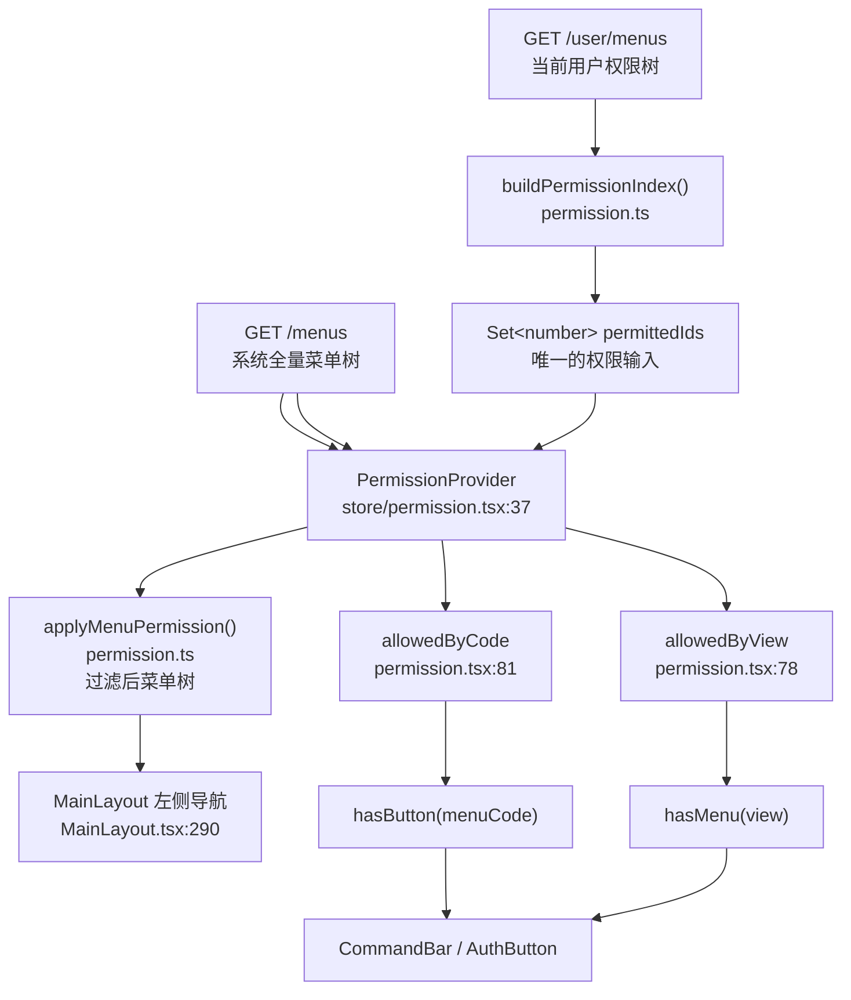

# 权限模块代码路径

> 基准版本：`main` @ `99f6b58`（2026-10-07）
> 说明：文中行号基于该版本，后续改动会导致行号漂移，函数名与文件路径相对稳定。
> **2026-10-08 分层调整**：原 `src/services`（接口封装）已改名 `src/api`；
> 权限的纯函数逻辑拆到 `src/services/permission.ts`。下文路径已按新结构更新。

---

## 一、一句话结论

整个前端权限体系只有**一条判定规则**：

```
用户权限树里的 id  命中  系统菜单节点的 ViewID  →  有权限
```

菜单过滤、按钮显隐、页面级判断**查的是同一个 `Set<number>`**，因此：

> **改这一个 Set，菜单与按钮权限会一起变。** 这是接入「超级管理员」等全局特权最省事的切入点。

---

## 二、权限模型

### 2.1 两份数据源

| 数据 | 接口 | 类型 | mock 文件 |
|---|---|---|---|
| 系统全量菜单树 | `GET /menus` | `MenuNode[]` | `../src/api/mock/data/desktopMenu.json` |
| 当前用户权限树 | `GET /user/menus` | `UserMenuPermission[]` | `src/api/mock/data/user/menus.json` |

两份数据在 `src/store/permission.tsx:48-51` 用 `Promise.all` 并行拉取。

当前 mock 的 `user/menus.json` 是 **19 个顶层节点、494 个总节点**，覆盖面近似全量——
也就是说开发环境下看到「什么都能点」，是**数据恰好给了全量权限**，不是代码里有超管逻辑。

### 2.2 关键字段

| 字段 | 出现于 | 含义 |
|---|---|---|
| `View` | `DesktopMenu` | 页面路径，下划线分层，如 `V0189_V0279_V0280` |
| `ViewID` | `DesktopMenu` | 数字 id，**权限比对的唯一键** |
| `IsAction` | `DesktopMenu` | `true` = 按钮节点，不进入导航树 |
| `MenuCode` | `DesktopMenu` | 按钮唯一编码，供 `hasButton` 使用 |
| `Release` | `DesktopMenu` | 是否发布；`isNavigableMenu` 要求为 `true` |
| `id` | `UserMenu` | 与系统菜单的 `ViewID` 对应 |

### 2.3 类型定义位置

- `DesktopMenu` / `UserMenu` — `src/api/modules/power.ts`（接口层，随接口走）
- `PermissionIndex` / `MenuActionItem` / `MenuPermissionResult` — `src/services/permission.ts`（业务层）

统一从 `src/api/index.ts` 与 `src/services/index.ts` 转出。

---

## 三、调用链路



### 文字版链路

```
/api/modules/power.ts
  powerApi.desktopMenu() → GET /menus
  powerApi.userMenus()   → GET /user/menus
        │
        ▼
/store/permission.tsx  PermissionProvider
  buildPermissionIndex(userMenus)  →  Set<number> permittedIds      ← 唯一输入源
  applyMenuPermission(system, {ids}) →  { tree, actions }
        │
        ▼
  context: { menu, actions, buttons, hasButton, hasMenu }
        │
        ├── MainLayout         消费 menu（已过滤）→ antd Menu
        ├── CommandBar         消费 actions + hasButton
        └── AuthButton / Permission  消费 hasButton / hasMenu
```

---

## 四、核心文件逐个说明

### 4.1 `src/services/permission.ts` — 纯函数层

无 React 依赖，**可以单独写单测**。这是整个权限体系的算法核心。
接口封装（`powerApi`）在同域的 `src/api/modules/power.ts`。

| 导出 | 行号 | 作用 |
|---|---|---|
| `isNavigableMenu(node)` | `menu.ts:37-39` | `!node.IsAction && node.Release`，判断能否作为导航项 |
| `splitViewPath(view)` | `menu.ts:41-44` | `V0005_V0010` → `['V0005','V0010']` |
| `buildPermissionIndex(nodes)` | `menu.ts:52-62` | 把用户权限树递归拍平成 `Set<number>` |
| `applyMenuPermission(system, index)` | `menu.ts:94-125` | 系统菜单与用户权限求交，输出可见树 + 按钮表 |
| `menuService` | `menu.ts:127-132` | `tree()` / `userMenus()` 两个接口（现名 `powerApi`，在 `src/api/modules/power.ts`） |

**私有函数（未导出）**：

```ts
// power.ts:65-67 —— 全部权限判断的最终落点
function hasPermission(node: MenuNode, index: PermissionIndex): boolean {
  return index.ids.has(node.ViewID);
}
```

**`applyMenuPermission` 的过滤规则**（`menu.ts:97-122`）：

1. `node.IsAction === true` 的节点直接跳过，不进导航树（`menu.ts:101`）；
2. 把该节点下 `IsAction` 的子节点收集成 `actions[view]`（`menu.ts:103-115`）；
3. 节点自身有权 **或** 存在有权的子菜单 → 保留（`menu.ts:117`）。

第 3 条很关键：**父菜单会因为子菜单有权而被保留**，所以即使父级没显式授权，只要子级有权限，父级依然会出现。

### 4.2 `src/store/permission.tsx` — 状态层

```ts
// permission.tsx:41  唯一输入
const [permittedIds, setPermittedIds] = useState<Set<number>>(() => new Set());

// permission.tsx:48-54  加载
const [systemRes, permissionRes] = await Promise.all([menuService.tree(), menuService.userMenus()]);
setSystem(systemRes.data);
setPermittedIds(buildPermissionIndex(permissionRes.data).ids);

// permission.tsx:69  消费
const { tree, actions } = applyMenuPermission(system, { ids: permittedIds });
```

暴露的 context（`permission.tsx:12-25`）：

| 字段 | 行号 | 说明 |
|---|---|---|
| `loading` | — | 权限是否加载中，`MainLayout.tsx:285` 用它显示 Spin |
| `menu` | `:91` | 已过滤的菜单树 |
| `actions` | `:92` | `Map<View, MenuActionItem[]>`，页面按钮权限表 |
| `buttons` | `:93` | `Map<MenuCode, MenuNode>`，系统菜单里的按钮节点 |
| `hasButton(menuCode)` | `:94` | 查 `allowedByCode`，未命中返回 `false` |
| `hasMenu(view)` | `:95` | 查 `allowedByView`，未命中返回 `false` |

`allowedByCode` / `allowedByView` 在 `permission.tsx:76-87` 的 `walk()` 里建立，
依然是 `permittedIds.has(node.ViewID)` —— **和算法层同一条规则**。

> 注意：`PermissionProvider` 挂载在 `App.tsx:33`，**位于 `ProtectedRoute` 内部**，
> 所以只有登录后才会去拉权限；登出会随组件卸载一并清空（不会残留）。

### 4.3 `src/components/Permission.tsx` — 声明式封装

```tsx
// Permission.tsx:22-31  包裹式：无权限时整棵子树不渲染
<Permission menuCode="..."><Button>新增</Button></Permission>
<Permission view="V0005_V0010"><SomeBlock /></Permission>

// Permission.tsx:45-50  按钮式：无权时返回 null，用法与 antd Button 完全一致
<AuthButton menuCode={createAction.menuCode}>新增部门</AuthButton>
```

两者判断逻辑一致（`Permission.tsx:29` / `:47`）：

```ts
const allowed = menuCode ? hasButton(menuCode) : view ? hasMenu(view) : true;
```

**都没传 `menuCode` 也没传 `view` 时返回 `true`** —— 即默认放行。

### 4.4 `src/components/CommandBar.tsx` — 命令栏

`CommandItem` 的三个权限相关字段（`CommandBar.tsx:12-18`）：

| 字段 | 说明 |
|---|---|
| `permission?: string` | 该命令在**系统菜单里声明的按钮名**（如 `新增` / `编辑` / `发布`） |
| `menuCode?: string` | 直接指定 MenuCode，**优先级高于 `permission`** |
| `disabled?: boolean` | 纯业务禁用标志（如未选中行），**与权限无关** |

解析流程（`CommandBar.tsx:41-75`）：

```
item.permission
   ├─ 有 → 在该页 actions 里找同名按钮
   │        ├─ 找不到 且 没给 menuCode  → 整个按钮不渲染（return []）   :49
   │        └─ 找到 → 取 action.menuCode
   └─ 没有 → menuCode 为 undefined
                    │
                    ├─ menuCode 有值 → <AuthButton menuCode={...}>   :65-68
                    └─ menuCode 无值 → <Button>（不判权限）           :69-73
```

**`view` prop 不传时 `actions` 查不到任何按钮，等于全部不判权限**（`CommandBar.tsx:27-28` 注释已说明）。

### 4.5 `src/layouts/MainLayout.tsx` — 菜单渲染

```ts
// MainLayout.tsx:119  取已过滤菜单（权限已在这一步之前做完）
const { menu: menuTree, loading: menuLoading } = usePermission();

// MainLayout.tsx:148-149
const displayTree = useMemo(() => filterMenuTree(menuTree, menuKeyword), [menuTree, menuKeyword]);
const menuItems = useMemo(() => buildMenuItems(displayTree, 0), [displayTree]);

// MainLayout.tsx:290  渲染
<Menu items={menuItems} onClick={handleMenuClick} ... />
```

**重要**：`filterMenuTree`（`MainLayout.tsx:64-80`）和 `buildMenuItems`（`:82-101`）
**只做关键字搜索 + `isNavigableMenu` 过滤，不做任何权限判断** —— 权限过滤在 store 层已经完成。
排查菜单不显示的问题时，要分清是「权限过滤掉了」还是「搜索没命中」。

另外 `tabMetaMap`（`MainLayout.tsx:131-146`）从 `menuTree` 构建 View → Tab 元数据（含面包屑层级），
`filterMenuTree` 里 `isNavigableMenu` 不通过的节点会连同子树一起丢弃。

### 4.6 页面级用法

**通用列表页** `src/pages/ViewPage.tsx`：

```ts
// ViewPage.tsx:29,37
const { actions, hasButton } = usePermission();
const actionItems = actions.get(view) ?? [];

// ViewPage.tsx:38-47  编辑/删除列的显隐
const canEdit = useMemo(() => {
  if (actionItems.length === 0) return true;        // ← 宽松策略，见第七节
  const item = actionItems.find((e) => ['编辑', '修改'].includes(e.name));
  return item ? hasButton(item.menuCode) : false;
}, [actionItems, hasButton]);
// canDelete 同理，匹配 ['删除', '移除']
```

结果作用在 `columns` 的构建上（`ViewPage.tsx:97-122`）：`canEdit` / `canDelete` 为 false 时，
对应操作列**根本不生成**，从数据层面就不存在。

**专用页面** `src/pages/views/V0005/V0010/index.tsx`（基础资料 > 部门设定）是同一套写法的完整示例：

- `:29-40` 同样的 `actionItems` / `canEdit` / `canDelete`
- `:165-176` 新增按钮用 `<AuthButton menuCode={createAction.menuCode}>` 包裹

新增一个专用页面时，照抄这个文件的模式即可。

---

## 五、使用方式速查

| 场景 | 写法 | 文件 |
|---|---|---|
| 页面级显隐（包裹整块） | `<Permission view={view}>...</Permission>` | `components/Permission.tsx:22` |
| 按钮，已知 MenuCode | `<AuthButton menuCode="...">保存</AuthButton>` | `components/Permission.tsx:45` |
| 命令栏按钮 | `items` 里给 `permission: '新增'` | `components/CommandBar.tsx:16` |
| 表格列/自定义逻辑 | `const { hasButton, hasMenu } = usePermission()` | `store/permission.tsx:29` |
| 拿当前页按钮表 | `const items = actions.get(view) ?? []` | `store/permission.tsx:92` |

命令栏完整示例（`V0189/V0279/V0280/index.tsx:104-131`）：

```tsx
{ key: 'add',     label: '新增',       icon: <PlusOutlined />, permission: '新增' },
{ key: 'edit',    label: '修改',       icon: <EditOutlined />, permission: '编辑', disabled: !hasSelection },
{ key: 'publish', label: '发布',       icon: <SendOutlined />, permission: '发布', disabled: !hasSelection },
{ key: 'auth',    label: '权限',       icon: <SafetyOutlined />, permission: '权限管理' },
```

---

## 六、数据加载时序

```
App 挂载
 └─ AuthProvider                        store/auth.tsx
     └─ ProtectedRoute                  App.tsx:15   （只验登录态）
         └─ PermissionProvider          App.tsx:33
             ├─ loading = true
             ├─ Promise.all([/menus, /user/menus])     permission.tsx:48
             ├─ setSystem(...) / setPermittedIds(...)  permission.tsx:53-54
             └─ loading = false
                 └─ useMemo 重算 → menu / actions / hasButton / hasMenu
```

- 加载期间 `loading` 为 `true`，`MainLayout.tsx:285-288` 显示 `<Spin />`；
- 接口失败时 `permission.tsx:55-58` 只弹一条 `message.error`，**不做降级**——
  此时 `system` 为空、`permittedIds` 为空，结果是**菜单全空**；
- 权限状态只存在内存，**页面刷新会重新拉取**（`useEffect` 依赖 `[message]`，只跑一次）。

---

## 七、不经过权限判定的地方（重要）

以下位置**完全绕过**权限体系，做精细权限时必须单独处理：

| # | 位置 | 说明 |
|---|---|---|
| 1 | `CommandBar` 中未声明 `permission` / `menuCode` 的命令 | `CommandBar.tsx:69-73` 走普通 `<Button>`，无条件渲染 |
| 2 | GridTable 右键菜单 / 表头菜单 | `GridTable.tsx` 的 `menu` 配置无任何权限过滤 |
| 3 | `actionItems.length === 0 → return true` | `ViewPage.tsx:39,44`、`views/V0005/V0010/index.tsx:32,37` |
| 4 | 路由层 | `App.tsx:15-21` 只验登录态；`registry.ts:45-54` 的 `resolveView` 不做权限校验 |

第 1 条的具体清单（`V0189/V0279/V0280/index.tsx:117-129`，共 10 个）：
取消 / 复制 / 已下订单复制 / 变更日志 / 已下单 / 分批 / 预订的阶段 / 刷新 / 列宽自适应 / 导出。

第 3 条的语义是「**系统菜单没声明按钮就一律放行**」。安全上更稳妥的做法是反过来——
**没配置就拒绝**，否则以后新增页面忘了配权限，就默认对所有人开放。

第 4 条当前风险较低：项目里视图没有 URL 路由，页面只能通过左侧菜单打开，
所以「菜单不渲染 = 点不进去」。若将来引入 URL 路由，需要补一道 `hasMenu(view)` 校验。

---

## 八、常见改造场景

### 8.1 给某个页面加按钮权限

1. 在系统菜单 `menu.json` 里为该菜单加 `IsAction: true` 的子节点，记下它的 `ViewID` 和 `MenuCode`；
2. 给目标用户/角色的 `user/menus.json` 加上对应 `id`；
3. 页面里给命令加 `permission: '<按钮名>'`，或用 `<AuthButton menuCode="...">` 包裹。

无需改任何算法代码。

### 8.2 加「超级管理员 = 全部权限」

**不要用 `username === 'admin'` 判断**——`UserInfo`（`store/auth.tsx:3-6`）只有 `username`
且存在 localStorage(`boda_user`)，改名即成超管。

推荐做法（服务端数据授予）：让超管用户的 `/user/menus` 直接返回全量权限树。
前端**零改动**，`applyMenuPermission` / `hasButton` / `hasMenu` 全部自然全开，
且不存在「前端放行了、后端忘了放行」的两套判定路径。

如需前端特判，**短路点只能放在最上游**：

```ts
// src/services/permission.ts —— 超管时等价于「授予全部权限」
export function buildPermissionIndex(
  nodes: UserMenuPermission[],
  superAdminIds?: Set<number>,
): PermissionIndex {
  if (superAdminIds) return { ids: superAdminIds };   // 走同一套下游，无特判分支
  // ...原逻辑不变
}
```

`superAdminIds` 由系统菜单全部节点（含 `IsAction`）的 `ViewID` 收集而来。

> **坑**：如果把短路放在 `hasButton` / `hasMenu`，菜单树仍会被 `applyMenuPermission` 过滤，
> 超管会变成「按钮全开、左侧菜单缺一大半」——UI 严重不一致。

超管标识必须来自**接口响应**并**只放内存**（与 `permittedIds` 同样待遇），
切勿落 localStorage，否则又回到「改一行变超管」。

前端短路只是 UI 一致性优化，**不是安全边界**，后端必须独立校验。

### 8.3 接真实后端要改哪里

| 改动点 | 位置 |
|---|---|
| 接口地址 / 域名 | `src/api/request.ts:3` 的 `BASE_URL` 或 `.env` 的 `VITE_API_BASE_URL` |
| 关掉 mock | `.env.development` 的 `VITE_USE_MOCK=false` |
| 带 token | `request.ts:85-92`（当前从 localStorage 取 `boda_token` 拼 `Bearer`） |
| 登出 / 换用户后刷新权限 | `store/permission.tsx:43-66` 的 `useEffect` 需要能重新触发 |

---

## 九、注意事项与已知坑

1. **`hasPermission` 未导出**（`menu.ts:65`）。若需要单独复用，得先补 `export`。
2. **`MenuActionItem.allowed` 是死字段**：`menu.ts:112` 算出来了，但全库没有任何地方读它——
   页面都改用 `hasButton(item.menuCode)` 重新判断。改代码时不要误以为它生效。
3. **父子菜单的联动**：`applyMenuPermission` 中「父级因有权子级而被保留」（`menu.ts:117`），
   所以给子菜单授权会自动带出父级菜单，不需要额外授权父级。
4. **`CommandBar` 的 `view` 必须传**，否则 `actions.get(undefined)` 拿不到东西，等于全部不判权限。
5. **`disabled` 不是权限**：它只表达业务状态（如未选中行），不要用它替代权限控制。
6. **权限加载失败会导致菜单全空**（`permission.tsx:55-58` 无降级逻辑），
   排障时先看 Network 里 `/menus` 和 `/user/menus` 是否正常。
7. **`View` 与 `ViewID` 别混用**：`hasMenu` / `actions` 用 `View`（字符串），
   `permittedIds` 里存的是 `ViewID`（数字），两者通过 `DesktopMenu` 上的字段对应。
8. **相关但不属于本模块**：登录态见 `src/store/auth.tsx`，
   token 与请求头见 `src/api/request.ts`。
