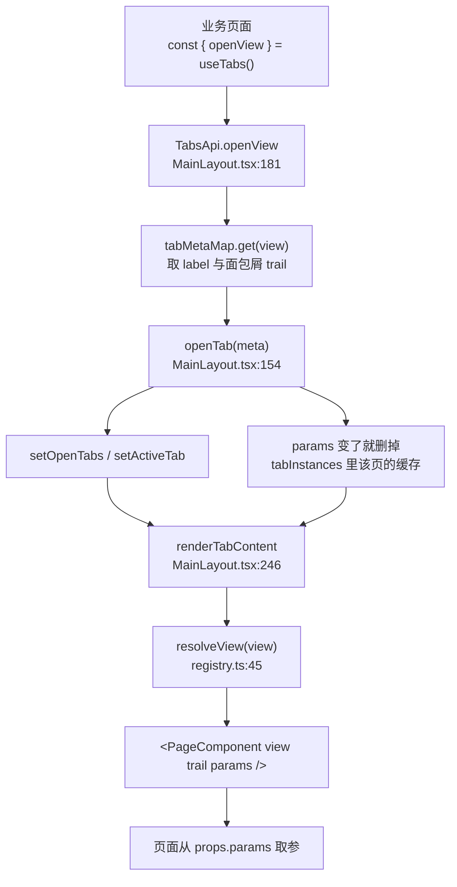

# 页面跳转与传参

> 基准版本：`main` @ `2ff145c`（2026-10-07）
> 说明：文中行号基于该版本，后续改动会导致行号漂移，函数名与文件路径相对稳定。

---

## 一、一句话结论

业务页面之间的跳转只有**一个入口**：

```tsx
const { openView } = useTabs();
openView('V0005_V0010_V0214', { keyword: 'X001' });
```

它做两件事：把目标 View 变成 MainLayout 里的一个标签页并激活；把 `params` 传给页面组件的 props。
页面既不需要知道标签页状态存在哪儿，也不需要碰 react-router。

---

## 二、用法

### 2.1 跳转（在任意业务页面里）

```tsx
import { useTabs } from '@/store/tabs';
import type { ViewPageProps } from '@/pages/types';

const PreorderPage: React.FC<ViewPageProps> = ({ view, trail }) => {
  const { openView } = useTabs();

  return (
    <Button onClick={() => openView('V0005_V0010_V0214', { keyword: 'X001' })}>
      查看部门
    </Button>
  );
};
```

不带参数就只传 View：`openView('V0005_V0010_V0214')`。

### 2.2 接收参数（在目标页面里）

```tsx
const DepartmentPage: React.FC<ViewPageProps> = ({ view, trail, params }) => {
  const keyword = params?.keyword as string | undefined;
  // 直接当初始值用即可：useState(() => keyword)、初始 query 等，不用写监听
};
```

### 2.3 行为规则

| 调用情况 | 结果 |
|---|---|
| 目标 View 没打开过 | 新开标签并激活，页面挂载，`params` 生效 |
| 已打开，`params` 与上次**相同** | 只激活，页面**不重建**（不打断页面上正在做的事） |
| 已打开，`params` 与上次**不同** | 复用同一个标签，页面**重新挂载**，拿到新 `params` |
| 点左侧菜单打开 | 等价于 `openView(view)`（无参），会重置掉之前带参打开的状态 |
| 同一个 View | **永远只有一个标签**，不会开出两个同名标签 |

> `params` 的"相同/不同"按 `JSON.stringify` 的**值**比较（见 `MainLayout.tsx:246` 的缓存 key），
> 所以传个新对象但内容一样，也不会触发重建。

---

## 三、为什么不做成 router 驱动

### 3.1 多标签页是两个正交的状态

| 状态 | 例子 | 能否映射到 URL |
|---|---|---|
| 哪些页面开着 | 工作台 + 预订单 + 部门设定 | ❌ 表达不了（除非把整个列表塞进 query） |
| 当前在哪一页 | 预订单 | ✅ |

router 只能接管后一半，落点必然是「URL 管当前页 + state 管已打开集合」的混合模型，
复杂度不会比现在低。

### 3.2 Electron 环境让 router 的收益打折

先澄清一个容易误判的点：**本项目不是 `file://` 加载的**。
`app/main.ts:31-53` 的 `startStaticServer()` 起了个内置 HTTP 静态服务器，带 SPA fallback
（找不到实际文件就回 `index.html`），生产环境走 `loadURL('http://localhost:' + port)`。
所以 `BrowserRouter` 在这里是能用的，刷新页面也不会 404。

但 Electron **没有地址栏**，"URL 可分享 / 可收藏"这个 router 最大的收益直接归零。
真正剩下的只有三条：

- 刷新后停在当前页（当前实现刷新会回到工作台）
- `Alt+←/→` 前进后退
- 未来的多窗口、通知点开直接跳某张单据

### 3.3 结论：先抽象、后实现

页面只依赖 `openView(view, params)` 这个抽象，不关心底层是 `setState` 还是 `navigate`。
将来若要转 router：

1. 改 `MainLayout.tsx:181` 的 `tabsApi`，把实现换成 `navigate('/view/' + view, { state: params })`
2. 让 `activeTab` 从 `useParams()` 推导，而不是内部的 `useState`
3. **页面代码零改动**

---

## 四、实现

### 4.1 涉及文件

| 文件 | 作用 |
|---|---|
| `src/store/tabs.tsx` | `TabsApi` / `TabsContext` / `useTabs()`，唯一的对外入口 |
| `src/pages/types.ts:22` | `ViewPageProps.params` |
| `src/layouts/MainLayout.tsx` | 标签页状态、`openTab`、`tabsApi`、页面的挂载与渲染 |
| `src/pages/registry.ts:45` | `resolveView()`，View → 页面组件 |

### 4.2 调用链路



### 4.3 三处关键实现

**① 唯一的对外出口** — `src/store/tabs.tsx:6-33`

```tsx
export interface TabsApi {
  openView: (view: string, params?: Record<string, unknown>) => void;
}
```

之所以能用 Context 而不是 router：本项目的多标签页是 MainLayout 自己用 state 管的
（`openTabs` / `activeTab`，`MainLayout.tsx:125-128`），路由只服务 `/login`，
跳页面必须落到 MainLayout 的 `openTab` 上，所以直接把那个能力透出来。

**② `params` 变了就丢掉页面缓存** — `MainLayout.tsx:154`

```tsx
if (prev[index].params === meta.params) return prev;
tabInstances.current.delete(meta.key); // 不删就会复用带旧参数的旧元素
```

`tabInstances`（`MainLayout.tsx:131`）缓存的是 React 元素，用来在切换标签时**不重建**页面、
保住页面上的状态。所以换参数时必须把它清掉。

**③ 参数指纹做 key，强制重挂载** — `MainLayout.tsx:246`

```tsx
key={`${meta.key}::${JSON.stringify(meta.params ?? null)}`}
```

少了这个 key，React 会复用组件实例、只更新 props —— 页面内部那些"用 params 初始化的 state"
还是旧值，看起来就像参数没生效。

---

## 五、已知取舍

- **一个 View 同时只能有一个标签。** "同时看两张不同筛选条件的预订单"做不到；
  真要支持，得把 tab key 从 `view` 改成 `view + 参数指纹`（当前故意没这么做，避免标签爆炸）。
- **点菜单会重置参数**（见 2.3 表格最后两行）。
- **`params` 按值比较**（`JSON.stringify`），不适合放大对象、循环引用或函数。
- **刷新页面所有标签会丢失并回到工作台。** 这是当前实现的既定行为，不是 bug；
  要保留得做持久化，或按 3.3 转成 router 驱动。

---

## 六、相关文档

- [权限模块代码路径](./权限模块代码路径.md) — 菜单树结构、`View` 字段的含义、`isNavigableMenu` 等
