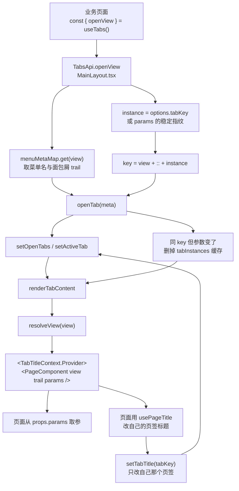

# 页面跳转与传参

> 基准版本：`main` @ `2ff145c`（2026-10-07），2026-10-21 补充「多页签 + 自定义标题」
> 说明：文中行号基于该版本，后续改动会导致行号漂移，函数名与文件路径相对稳定。

---

## 一、一句话结论

业务页面之间的跳转只有**一个入口**：

```tsx
const { openView } = useTabs();
openView('V0005_V0010_V0214', { keyword: 'X001' });
```

它做三件事：把目标 View 变成 MainLayout 里的一个标签页并激活；把 `params` 传给页面组件的 props；
按 `params` 区分页签身份（**参数一样是同一个页签，参数不一样各开一个**，可以同时看几张单子）。
页面既不需要知道标签页状态存在哪儿，也不需要碰 react-router。

页签标题默认是菜单名，页面可以按**数据内容**改（订单详情页显示订单号），见 [2.5](#25-自定义页签标题)。


---

## 二、用法

### 2.1 跳转（在任意业务页面里）

```tsx
import { useTabs } from '@/store/tabs';
import type { ViewPageProps } from '@/pages/types';

const PreorderPage: React.FC<ViewPageProps> = ({ view, trail }) => {
  const { openView } = useTabs();

  return (
    <Button onClick={() => openView('V0005_V0010_V0214', { keyword: 'X001' })}>
      查看部门
    </Button>
  );
};
```

不带参数就只传 View：`openView('V0005_V0010_V0214')`。

### 2.2 接收参数（在目标页面里）

```tsx
const DepartmentPage: React.FC<ViewPageProps> = ({ view, trail, params }) => {
  const keyword = params?.keyword as string | undefined;
  // 直接当初始值用即可：useState(() => keyword)、初始 query 等，不用写监听
};
```

### 2.3 行为规则

| 调用情况 | 结果 |
|---|---|
| 目标 View 没打开过 | 新开标签并激活，页面挂载，`params` 生效 |
| 已打开，`params` 与上次**相同** | 只激活，页面**不重建**（不打断页面上正在做的事） |
| 已打开，`params` 与上次**不同** | **新开一个标签**，各单据可以同时对照着看 |
| 点左侧菜单打开 | 打开该菜单的**默认标签**（无参），已开着就只激活 |
| 同一个 View | 可以有**多个标签**（参数不同各一个） |

> `params` 的"相同/不同"按**键排序后的稳定序列化**比较（见 `src/store/tab-key.ts`），
> 所以传个新对象但内容一样，也不会多开标签。

### 2.4 页签怎么区分（菜单单标签 / 代码多标签）

页签的唯一标识 = `view` + `::` + **实例标识**。实例标识决定"算同一个页签还是新页签"：

| 来源 | 实例标识 | 结果 |
|---|---|---|
| 点左侧菜单 | 空 | key 就是 `view` —— **同一菜单永远只有一个标签**，已开着只激活 |
| `openView(view, params)` | `params` 的稳定指纹 | **参数一样 → 同一页签；参数不一样 → 各开一个** |
| `openView(view, params, { tabKey })` | 业务指定的 key | **相同 key → 同一页；不同 key → 新页** |

`tabKey` 是给"判断参数不方便"的场景准备的：比如参数里塞了时间戳、随机数，
或者同一份数据要开两个页签，业务自己传一个稳定的 key 说了算：

```tsx
openView('V0189_V0279_V0281', { orderCode: 'AFS-225' });
// → 页签「预订单变更明细 · AFS-225」

openView('V0189_V0279_V0281', { orderCode: 'AFS-210-4' });
// → 另一个页签「预订单变更明细 · AFS-210-4」，两个可同时看
```

### 2.5 自定义页签标题

页签标题默认是菜单名，但可以按**数据内容**改 —— 比如订单详情页显示订单号。

```tsx
// 页面里：数据到了就把标题改掉
import { usePageTitle, useTabTitle } from '@/store/tab-title-context';

const { baseLabel } = useTabTitle();
usePageTitle(orderCode ? `${baseLabel} · ${orderCode}` : undefined);
// 传 undefined = 恢复成菜单名
```

- 作用域是**页签自己**（每个页签渲染时套一层 Provider），不会改到别的页签上；
- 标题同时作用于**页签文字**与**窗口标题**（`document.title`）；
- 桌面壳那边（MyGo）原生窗口标题默认跟随页面的 `<title>`，所以桌面窗口标题也会跟着变。

也可以在打开时就给定标题（页面若随后自己改了，以页面改的为准）：

```tsx
openView('V0189_V0279_V0281', { orderCode }, { title: '预订单变更明细 · AFS-225' });
```


---

## 三、为什么不做成 router 驱动

### 3.1 多标签页是两个正交的状态

| 状态 | 例子 | 能否映射到 URL |
|---|---|---|
| 哪些页面开着 | 工作台 + 预订单 + 部门设定 | ❌ 表达不了（除非把整个列表塞进 query） |
| 当前在哪一页 | 预订单 | ✅ |

router 只能接管后一半，落点必然是「URL 管当前页 + state 管已打开集合」的混合模型，
复杂度不会比现在低。

### 3.2 Electron 环境让 router 的收益打折

先澄清一个容易误判的点：**本项目不是 `file://` 加载的**。
`app/main.ts:31-53` 的 `startStaticServer()` 起了个内置 HTTP 静态服务器，带 SPA fallback
（找不到实际文件就回 `index.html`），生产环境走 `loadURL('http://localhost:' + port)`。
所以 `BrowserRouter` 在这里是能用的，刷新页面也不会 404。

但 Electron **没有地址栏**，"URL 可分享 / 可收藏"这个 router 最大的收益直接归零。
真正剩下的只有三条：

- 刷新后停在当前页（当前实现刷新会回到工作台）
- `Alt+←/→` 前进后退
- 未来的多窗口、通知点开直接跳某张单据

### 3.3 结论：先抽象、后实现

页面只依赖 `openView(view, params)` 这个抽象，不关心底层是 `setState` 还是 `navigate`。
将来若要转 router：

1. 改 `MainLayout.tsx:181` 的 `tabsApi`，把实现换成 `navigate('/view/' + view, { state: params })`
2. 让 `activeTab` 从 `useParams()` 推导，而不是内部的 `useState`
3. **页面代码零改动**

---

## 四、实现

### 4.1 涉及文件

| 文件 | 作用 |
|---|---|
| `src/store/tabs.tsx` | `TabsApi` / `TabsContext` / `useTabs()`，唯一的对外入口 |
| `src/store/tab-key.ts` | 页签 key 的计算：实例标识、key 拼装、参数比较 |
| `src/store/tab-title-context.ts` | 页签标题作用域 + `useTabTitle()` / `usePageTitle()` |
| `src/utils/string.ts` | `stableStringify()`，键排序的稳定序列化 |
| `src/pages/types.ts:22` | `ViewPageProps.params` |
| `src/layouts/MainLayout.tsx` | 标签页状态、`openTab`、`tabsApi`、页面的挂载与渲染 |
| `src/pages/registry.ts:45` | `resolveView()`，View → 页面组件 |

### 4.2 调用链路



### 4.3 四处关键实现

**① 唯一的对外出口** — `src/store/tabs.tsx`

```tsx
export interface TabsApi {
  openView: (
    view: string,
    params?: Record<string, unknown>,
    options?: OpenViewOptions,   // { tabKey?, title? }
  ) => void;
}
```

之所以能用 Context 而不是 router：本项目的多标签页是 MainLayout 自己用 state 管的
（`openTabs` / `activeTab`），路由只服务 `/login`，
跳页面必须落到 MainLayout 的 `openTab` 上，所以直接把那个能力透出来。

**② 页签 key = view + 实例标识** — `src/store/tab-key.ts`

```tsx
const instance = options?.tabKey ?? instanceOfParams(params);
const key = buildTabKey(view, instance);   // instance 为空 → key 就是 view
```

**菜单点进来的实例标识恒为空**，所以同一菜单永远只有一个标签；
**代码打开的按参数指纹区分**，参数不同就各开一页。
`instanceOfParams` 用 `stableStringify`（键排序）而不是 `JSON.stringify` ——
后者按插入顺序拼，`{a:1,b:2}` 与 `{b:2,a:1}` 会算成两个页签。

**③ 页面标题作用域绑定到页签自己** — `src/store/tab-title-context.ts`

```tsx
const scope: TabTitleScope = {
  tabKey: meta.key,
  baseLabel: meta.label,
  setTitle: (title) => setTabTitle(meta.key, title),
};
node = (
  <TabTitleContext.Provider value={scope}>
    <Suspense ...><PageComponent ... /></Suspense>
  </TabTitleContext.Provider>
);
```

每个页签渲染时套一层 Provider，页面拿到的就是**自己那个页签**的作用域 ——
多个订单页签同时开着时，改标题不会串页。
`setTabTitle` 只改 `openTabs` 里对应项，**不动 `tabInstances` 的元素缓存**，
所以改标题不会导致页面重挂载、页面上正在做的事不会被打断。

**④ 参数指纹做 key，强制重挂载** — `MainLayout.tsx`

```tsx
key={`${meta.key}::${JSON.stringify(meta.params ?? null)}`}
```

少了这个 key，React 会复用组件实例、只更新 props —— 页面内部那些"用 params 初始化的 state"
还是旧值，看起来就像参数没生效。

---

## 五、已知取舍

- **`params` 按稳定序列化比较**（`stableStringify`），不适合放大对象、循环引用或函数；
  这类参数请改用 `options.tabKey` 自己指定页签身份。
- **页签不会自动去重**：同一 View 用不同参数反复打开会开出一串页签（这是"同时看几单"要的效果）。
  菜单入口只有一个默认标签，代码入口按需展开。
- **刷新页面所有标签会丢失并回到工作台。** 这是当前实现的既定行为，不是 bug；
  要保留得做持久化，或按 3.3 转成 router 驱动。


---

## 六、相关文档

- [权限模块代码路径](./权限模块代码路径.md) — 菜单树结构、`View` 字段的含义、`isNavigableMenu` 等
